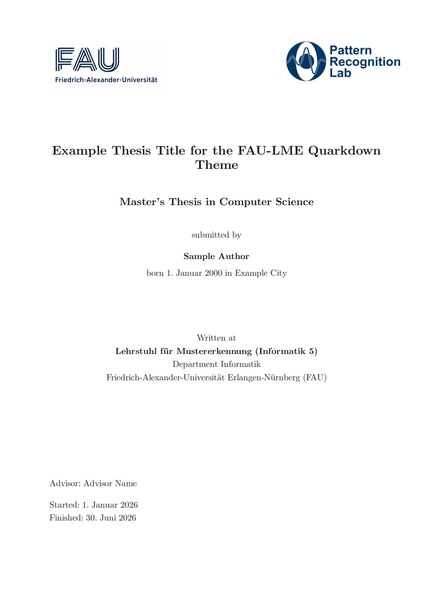
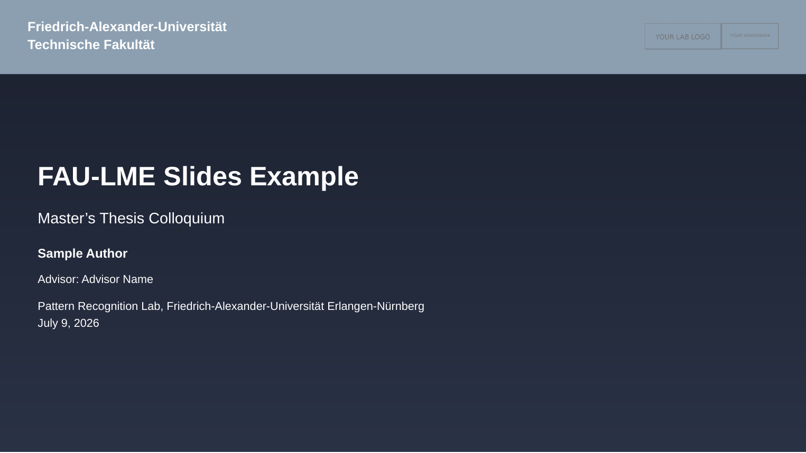

# FAU-LME Quarkdown Theme

[](https://github.com/evrenverse/fau-lme-quarkdown/actions/workflows/ci.yml)
[](https://github.com/evrenverse/fau-lme-quarkdown/actions/workflows/codeql.yml)
[](https://scorecard.dev/viewer/?uri=github.com/evrenverse/fau-lme-quarkdown)
[](CHANGELOG.md)
[](LICENSE)

A Quarkdown theme that reproduces the look of the FAU Pattern Recognition Lab (LME) LaTeX thesis template (`lmedoc.cls`), for students at the Lehrstuhl für Mustererkennung who want to write their thesis or project work (Projektarbeit, Forschungspraktikum, Studienarbeit) in [Quarkdown](https://github.com/iamgio/quarkdown) instead of LaTeX.

<p align="center">
  
  &nbsp;&nbsp;
  
</p>

<p align="center">
  <sub>Both rendered from <code>example/</code> and <code>example-slides/</code> — build them yourself with <code>scripts/test.sh</code>.<br>
  The slide artwork is a placeholder; see <a href="assets/LOGO-PROVENANCE.md">LOGO-PROVENANCE.md</a>.</sub>
</p>

## What you get

- A4 twoside, 12 pt Latin Modern Roman (`LM Roman 12`, resolved by fontconfig to the glyph-compatible `CMU Serif` Computer Modern Unicode rebuild — what `lmedoc.cls` + `lmodern` actually renders), 1.5 line spacing.
- **Parameterised cover page** with the FAU TechFak + LME logos, as shipped by the chair's LaTeX template (see § Brand assets). Doctype switch (`mt`/`bt`/`sa`/`pa`/`fp`/`diss`) and English/German label dispatch.
- **Front-matter handling**: roman page numbers (no running header) for cover/Erklärung/abstract/ToC; arabic + running chapter heading from chapter 1 onward.
- **15 LaTeX-equivalent math macros** as KaTeX `.texmacro`s — vectors, matrices, norms, number sets, optimization operators, floor/ceiling/big-O.
- **Custom CSL bibliography style** carrying alpha-style citation labels (`[Pet07]`) approximating BibTeX `alphamod.bst` (per-entry labels stored in BibTeX `note` field — see § Refs.bib note-field hijack below for the rationale).
- **FAU-blue palette**: internal/citation links FAU-blue (#003366); external URLs FAU-magenta (#e6007e); colors drive the stock theme's `--qd-link-color` variable.
- **Caption positions**: figures bottom, tables top, code bottom — per LME convention.
- **Booktabs-style tables**: heavy top + bottom rule, lighter mid rule under header, no vertical lines.
- **EN + DE localization** for cover labels (`thesistype_*`, `submitted_by`, `born_on`, `advisor`, `started`, `finished`, …).

## Font choice

The theme defaults to **`LM Roman 12`** (Latin Modern Roman, 12-point optical-size cut). The reasoning, after iterative discovery:

`lmedoc.cls:48` uses `\usepackage{times}`, which initially suggests an Adobe-Times-clone like **Nimbus Roman** or a Times-New-Roman-clone like **Tinos**. But the chair's `thesis_main.tex` then loads `\usepackage{lmodern}` *after* the class — which overrides `\rmdefault` to LMRoman. Verified via `pdffonts template-2023-compiled-mt.pdf`: the embedded fonts are `LMRoman12-Bold/Regular/Italic`, not Times.

So: the LaTeX reference uses Latin Modern Roman, and we match it. On Linux/macOS, fontconfig resolves `LM Roman 12` to **CMU Serif** (Computer Modern Unicode), the glyph-compatible Unicode rebuild — `pdffonts` on the Quarkdown output shows `CMUSerif-Roman/Bold/Italic/BoldItalic`.

**Font prerequisites by OS:**

| OS | Install |
|---|---|
| Debian / Ubuntu | `apt install fonts-lmodern` (Latin Modern) and/or `fonts-cmu` (CMU Serif) |
| Fedora / RHEL | `dnf install texlive-lm cm-unicode-fonts` |
| Arch Linux | `pacman -S tex-gyre-fonts cm-unicode` |
| macOS | `brew install --cask font-latin-modern font-cmu` |
| Windows | install [Latin Modern](https://www.gust.org.pl/projects/e-foundry/latin-modern) + [CMU](https://cm-unicode.sourceforge.io/) manually |

Fallback: if neither `LM Roman 12` nor `CMU Serif` is available, change `.font main:{LM Roman 12}` to `.font main:{Latin Modern Roman}` (alternative resolution path) in `metadata.qd`. As last resort, `Tinos` or `Nimbus Roman` will compile but render visibly heavier than the LaTeX reference.

## Script prerequisites

The theme itself is plain Quarkdown — `.qd`, CSS and images, no toolchain
beyond Quarkdown itself. The helpers under `scripts/` are optional and have
their own dependencies:

```bash
pip install -r requirements.txt          # postprocessor + outline fixer
pip install -r requirements-dev.txt      # …plus the test suite
```

`scripts/print-pdf.js` additionally needs Node and Puppeteer, which it expects
in Quarkdown's own npm cache — it prints the exact install command if it is
missing.

## Quick start

1. **Add the theme** to your Quarkdown project — as a git submodule (recommended) or a plain copy. The repository root *is* the theme, so point it at the conventional `themes/fau-lme/` path next to your `main.qd`:
   ```bash
   # submodule at the conventional path:
   git submodule add https://github.com/evrenverse/fau-lme-quarkdown.git themes/fau-lme
   # …or a plain copy:
   git clone https://github.com/evrenverse/fau-lme-quarkdown.git
   cp -r fau-lme-quarkdown /path/to/your/project/themes/fau-lme
   ```

2. **Install the bibliography CSL style** into your Quarkdown installation (one-time, idempotent):
   ```bash
   themes/fau-lme/scripts/install-csl.sh
   ```
   This injects `lme-alpha.csl` into your `quarkdown-core.jar` so `.lmebibliography` can find it via `style:{lme-alpha}`. Requires `zip` (Debian/Ubuntu: `sudo apt-get install -y zip`). Set `QUARKDOWN_ROOT` env var if Quarkdown is installed somewhere other than `~/.local/opt/quarkdown`.

3. **In your `main.qd`:**

   ```qmd
   .doctype {paged}
   .include {metadata.qd}
   .include {themes/fau-lme/loader.qd}

   <!-- Front-matter: roman page numbering -->
   .formatpagenumber {i}

   .include {frontmatter/cover.qd}

   <!-- After cover: page number in the top-outer corner (matches LaTeX
        \pagestyle{headings}). Page 1 (cover) is auto-suppressed by the
        theme via a `:first` rule. -->
   .pagemargin {topoutsidecorner}
       .currentpage

   .include {frontmatter/declaration.qd}
   .include {frontmatter/abstract-de.qd}
   <!-- ... rest of front-matter ... -->

   <!-- Body: arabic numbering. Place the running header (lastheading)
        in `topoutside`. Front-matter pages auto-suppress the running
        header (only the page number stays). The arabic counter reset
        lives INSIDE chapters/ch01.qd, AFTER its `# Title` heading, so
        it takes effect on the chapter page itself rather than on the
        front-matter trailing page. -->
   .pagemargin {topoutside}
       *.lastheading depth:{1}*

   <!-- ... chapters ... -->

   .lmebibliography {refs.bib}
   ```

4. **In your `metadata.qd`:**

   ```qmd
   .docname {Your thesis title}
   .docauthor {Your Name}
   .doclang {english}              <!-- or {german}; controls cover localization -->

   .pageformat size:{A4} margin:{3.8cm 2.8cm 4.0cm 2.0cm} side:{right}
   .pageformat size:{A4} margin:{3.8cm 2.0cm 4.0cm 2.8cm} side:{left}

   .font main:{LM Roman 12} heading:{LM Roman 12} size:{12pt}
   ```

5. **In your `frontmatter/cover.qd`:**

   ```qmd
   .lmecover \
       title:{Your thesis title} \
       author:{Your Name} \
       birthdate:{1. Januar 2000} \
       birthplace:{City} \
       advisor:{Advisor Name} \
       started:{1. Januar 2026} \
       finished:{30. Juni 2026} \
       doctype:{mt}
   ```

   Date formatting is rendered verbatim — the convention used in the
   chair's LaTeX template is the German long form (`1. Januar 2026`).

6. **Build:** `quarkdown c main.qd --pdf`.

## `.lmecover` parameters

| Parameter | Required | Values | Meaning |
|---|---|---|---|
| `title` | yes | string | Thesis title |
| `author` | yes | string | Your full name |
| `birthdate` | yes | string | Date of birth (rendered verbatim) |
| `birthplace` | yes | string | Place of birth (rendered verbatim) |
| `advisor` | no | string | Advisor name; omitting it drops the whole bottom trailer (advisor/started/finished), e.g. for a Projektarbeit cover |
| `started` | no | string | Thesis start date (only rendered when `advisor` is set) |
| `finished` | no | string | Thesis end date (only rendered when `advisor` is set) |
| `doctype` | yes | `mt` / `bt` / `sa` / `pa` / `fp` / `diss` | Master / Bachelor / Student / Projektarbeit / Forschungspraktikum / Dissertation |
| `coinstitute` | no | string | Optional cooperation partner; renders as "in Cooperation with X" block |

**Language is controlled by `.doclang` in `metadata.qd`**, not by a function parameter. Setting `.doclang {english}` produces English cover labels ("Master's Thesis", "submitted by", "Advisor", "Started", "Finished", "Written at", …); `.doclang {german}` produces the German equivalents ("Master's Thesis im Fach Informatik", "vorgelegt von", "Betreuer", "Beginn der Arbeit", "Abgabe der Arbeit", "Angefertigt am", …). The cover's `.doctype` parameter is interpolated into the localization key (`.localize {lme:thesistype_.doctype}`), so combining doctype + language is automatic.

## `.lmebibliography` parameter

| Parameter | Required | Values | Meaning |
|---|---|---|---|
| `file` | yes | path | Path to your `.bib` file, relative to `main.qd`'s directory |

**Known limitation**: the wrapper internally prefixes the path with `../../` because Quarkdown 2.0.1 resolves `.bibliography` paths relative to the wrapper file's directory rather than the caller's. This means `refs.bib` must live next to `main.qd`. To use a different layout, edit `themes/fau-lme/bibliography.qd` and adjust the prefix.

## Math macros provided

Inline math: `$ \mat{A} \transp{\vec{x}} = \vec{b} $` (whitespace around `$` is **mandatory** in Quarkdown).

Display math: `$$$ \argmax_{\theta} \mathcal{L}(\theta) $$$` (triple-dollar fenced block — the standard `$$ ... $$` double-dollar form silently fails in PDF output).

| Macro | Renders as | Notes |
|---|---|---|
| `\vec{a}` | bold-italic *a* | Overrides KaTeX's arrow-accent `\vec` (LME convention) |
| `\mat{A}` | bold-italic *A* | Same KaTeX-override convention |
| `\transp{A}` | A^T | Roman upright T (renamed from LME `math.sty`'s `\transpose`) |
| `\norm{x}` | ‖x‖ | |
| `\abs{x}` | \|x\| | |
| `\real` | ℝ | |
| `\nat` | ℕ | Renamed from LME `\cardinal` for CS-convention clarity |
| `\integers` | ℤ | Renamed from `\integer` (pluralised) |
| `\complex` | ℂ | |
| `\rationals` | ℚ | Renamed from `\rational` (pluralised) |
| `\argmax`, `\argmin` | math operators with subscript-below positioning | `\operatorname*` form for limits |
| `\floor{x}`, `\ceil{x}` | ⌊x⌋, ⌈x⌉ | |
| `\bigO{n^2}` | O(n²) | Asymptotic complexity; renamed from LME `\complexity` |

If you need additional math symbols (e.g., `\unitvec`, `\half`, custom set notation), add them as project-local `.texmacro` definitions in your chapter file or a small project-side `.qd` library (e.g. `lib/extra-macros.qd` next to `main.qd`) — the theme intentionally ships only the 15 most common macros.

## Localization keys

The `.localization {lme}` table provides the following keys, with English and German values:

| Key | English | German |
|---|---|---|
| `thesistype_mt` | Master's Thesis in Computer Science | Master's Thesis im Fach Informatik |
| `thesistype_bt` | Bachelor's Thesis in Computer Science | Bachelor's Thesis im Fach Informatik |
| `thesistype_sa` | Student Thesis in Computer Science | Studienarbeit im Fach Informatik |
| `thesistype_pa` | Project in Computer Science | Projektarbeit im Fach Informatik |
| `thesistype_fp` | Forschungspraktikum in Computer Science | Forschungspraktikum im Fach Informatik |
| `thesistype_diss` | Dissertation in Informatik | Dissertation im Fach Informatik |
| `submitted_by` | submitted by | vorgelegt von |
| `born_on` | born | Geboren am |
| `born_in` | in | in |
| `written_at` | Written at | Angefertigt am |
| `in_cooperation` | in Cooperation with | in Zusammenarbeit mit |
| `lehrstuhl` | Lehrstuhl für Mustererkennung (Informatik 5) | (same — institution name) |
| `department` | Department Informatik | (same) |
| `university` | Friedrich-Alexander-Universität Erlangen-Nürnberg | (same) |
| `advisor` | Advisor | Betreuer |
| `started` | Started | Beginn der Arbeit |
| `finished` | Finished | Abgabe der Arbeit |

To add another locale (e.g., French), edit `themes/fau-lme/localization.qd` and add a parallel block under `.localization {lme}` with all 17 keys.

## Project structure

```
themes/fau-lme/
├── README.md              ← you are here
├── CHANGELOG.md
├── CONTRIBUTING.md
├── AGENTS.md              ← rules for coding agents working on the theme
├── SECURITY.md            ← trust model of the scripts, how to report a finding
├── SUPPORT.md
├── LICENSE                ← MIT, except the two cover logos (see § Brand assets)
├── requirements.txt       ← runtime deps of scripts/ (lxml, pygments, pymupdf)
├── requirements-dev.txt   ← …plus pytest and pypdf
├── loader.qd              ← .include {themes/fau-lme/loader.qd} from main.qd
├── styles.css             ← single source-of-truth for theme CSS (FAU palette + booktabs + caption + chapter-heading rules)
├── localization.qd        ← .localization {lme} (EN/DE)
├── cover.qd               ← .lmecover function
├── math.qd                ← 15 .texmacro definitions
├── captions.qd            ← .captionposition for figures/tables/code
├── bibliography.qd        ← .lmebibliography wrapper
├── scripts/
│   └── install-csl.sh     ← Idempotent installer for the CSL style into Quarkdown's JAR
└── assets/                    ← all placeholders, MIT — swap in your own branding
    ├── LOGO-PROVENANCE.md     ← sizes, slots, and how to replace them
    ├── logo-fau-techfak.png   ← upper cover logo slot
    ├── logo-lme.png           ← lower cover logo slot
    ├── logo-prl.png           ← lab logo slot (slides layer)
    ├── logo-fau-wortmarke.svg ← wordmark slot (slides layer)
    ├── slides-title-bg.jpg    ← title background (slides layer)
    └── csl/
        └── lme-alpha.csl  ← custom citation style (DIN-1505-derived + per-entry note-field hijack)
```

## Compatibility matrix

| Quarkdown version | Status | Notes |
|---|---|---|
| 2.5.1 | ✅ tested | Latest upstream release. Both examples build; the paged cover title wraps one word differently than on 2.3.1, page count and geometry are identical. |
| 2.3.1 | ✅ tested | Reference target — the slides layer's Reveal geometry shim was written against it. |
| 2.0.1 | ✅ tested | Original target. The `.qd` API used here is unchanged since. |
| 2.0.x – 2.5.x (other patches) | ❓ untested | Likely compatible; report regressions via issue. |
| < 2.0.0 | ❌ unsupported | Older Quarkdown lacks `.pageformat`, mirror-position pagemargins, and KaTeX `.texmacro` API. |

Run `bash themes/fau-lme/scripts/test.sh` after upgrading Quarkdown to spot regressions early — the example exercises the cover, math macros, ToC numbering, booktabs tables, citations, and the running header.

## Quarkdown-specific gotchas

This theme was developed against Quarkdown 2.0.1; behaviour may differ in other versions. Idioms worth knowing before you edit a `.qd` file here:

- **Inline math whitespace mandatory**: `$ a $`, never `$a$` (Quarkdown's KaTeX bridge silently fails without whitespace around `$`).
- **Display math: triple-dollar**: `$$$ … $$$` is the form that survives Chromium's PDF print; `$$ … $$` silently fails.
- **`.css {.read {file}}` must be inline-arg form**: the body form `.css\n    .read {file}` emits literal text into `<style>`. This theme's `loader.qd` uses the inline form.
- **`.include` paths are sibling-relative**: a file at `themes/fau-lme/foo.qd` referencing `themes/fau-lme/bar.qd` should say `.include {bar.qd}`, not `.include {themes/fau-lme/bar.qd}`.
- **`.pagemargin` has no `pages:` filter**: scope mid-document with `&nbsp;` body override + later re-set.
- **`.captionposition` accepts `top` / `bottom`** (not `default` or other values).
- **`.texmacro` parameters use LaTeX-style `#1` / `#2`** (not Quarkdown's `.a` syntax).
- **Quarkdown auto-injects `!important` on every CSS rule** loaded via `.css {.read {...}}`. No need to add it yourself.
- **`.bibliography style:{X}` is classpath-only**: X must be a CSL file inside `quarkdown-core.jar`, not a filesystem path. Hence `scripts/install-csl.sh`.

## Deliberate deviations from `lmedoc.cls`

The theme reproduces the LaTeX class closely, but not identically. These
differences are intentional — if you find one that is *not* in this list, it is
a bug worth reporting:

- **Page numbers stay in the top-outer corner on chapter-opening pages.** LaTeX
  switches to bottom-center there (`\thispagestyle{plain}`). Matching that would
  need per-page margin overrides, which Quarkdown does not expose.
- **The running header stays visible on chapter-opening pages**, for the same
  reason. To keep the heading from looking cramped underneath it, the
  chapter-open heading drop is 80 pt instead of LaTeX's 50 pt.
- **The running header reads `INTRODUCTION`, not `CHAPTER 1. INTRODUCTION`.**
  The chapter number stays visible through the page numbering; dropping the
  prefix follows modern academic typesetting and avoids the overflow the LaTeX
  reference shows with long chapter titles.
- **Chapters can open on a verso page.** LaTeX's `\cleardoublepage` forces
  recto-only chapter starts; Quarkdown's `.pagebreak` is a single break.
- **`submitted by` is one line**, where LaTeX breaks after `submitted`. The
  trade-off buys a single localization key instead of two half-sentence ones.

Known limitation: appendix sub-sections lose their numeric label, because
Quarkdown's `.numbering` cannot be re-targeted mid-document. Cross-references to
appendix sub-sections are therefore not numbered.

## Refs.bib note-field hijack

Your `refs.bib` uses the BibTeX `note` field to carry the manual alphamod-style citation label (e.g. `note = {Pef07}` for Peffers 2007). The CSL style reads this directly to render `[Pet07]`-style citations because citeproc-java doesn't propagate BibTeX's `citation-key` field to CSL's `citation-label` variable.

**Practical consequence**: if you want to add a free-form per-entry note, use `annote = {...}` instead of `note = {...}` — using `note` will silently hijack your citation label.

## License

MIT — see `LICENSE`. That covers the theme itself: the `.qd` sources, the CSS,
the scripts, the tests.

### Brand assets

`assets/logo-fau-techfak.png` and `assets/logo-lme.png` are the property of
Friedrich-Alexander-Universität Erlangen-Nürnberg and its Lehrstuhl für
Mustererkennung. **They are excluded from the MIT license above.**

They ship with the theme for the same reason they ship with the LaTeX template
it reproduces: so a member of the chair can clone the repository and build a
correct cover. The chair publishes that template openly — the two files here are
byte-identical to `lmedoc/FAU_TechFak_EN_H_RGB_darkblue-1.png` and
`lmedoc/logo_large.png` in
[`thesis-templates-master.zip`](https://lme.tf.fau.de/wp-content/uploads/2024/06/thesis-templates-master.zip).
Their intended use is work written under the chair's supervision.

Everything else in `assets/` is a placeholder created for this repository and
covered by the MIT license. `assets/LOGO-PROVENANCE.md` documents each slot,
its nominal size, and how to replace it.

### Using it outside FAU

Replace both cover logos (keeping their nominal sizes), adjust
`LOGO-PROVENANCE.md`, and the rest of the theme is yours under MIT. Institution
marks are commonly licensed for work produced under that institution's
supervision but not for redistribution inside a public template — so if your
fork is to carry different branding, confirm the terms with that institution's
corporate-design office.

## Contributing

Bug reports and PRs welcome. Particularly wanted:
- Additional locales (we ship EN/DE today).
- More LaTeX-equivalent math macros (we ship a 15-macro subset).
- A proper `diss` (Dissertation) cover variant (we ship the `mt`-style layout for all doctypes; LaTeX's `\dissdeckblatt` has a vertically-centered title page that we haven't yet implemented).
- Tests against newer Quarkdown versions (currently pinned to 2.0.1 behaviour).

See `CHANGELOG.md` for the release history.
